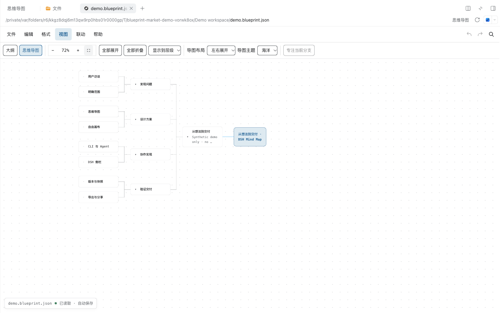
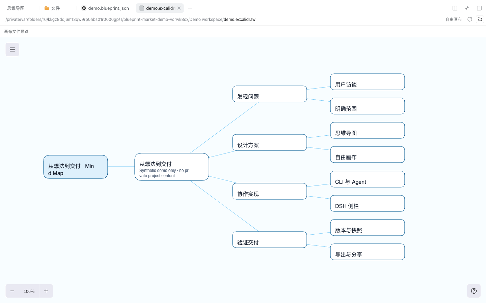

# DSH plugin installation verification

Tested on 2026-10-10 with the public npm package **`@1agents/feature-blueprint@0.4.1`**, installed from a byte-verified tarball. The root package provides the plugin and CLIs; `packages/dsh-plugin` is private development source and must not be advertised as a separate install target.

## Artifact

- Official npm tarball: https://registry.npmjs.org/@1agents/feature-blueprint/-/feature-blueprint-0.4.1.tgz
- Size: 5,496,140 bytes.
- SHA-256: `5e4ef5ed55be7956373003a66bfd940312c887498037950b2f72713e6c896216`.
- SHA-512 matches the registry integrity. See [machine-readable evidence](artifact-verification.json).
- Package includes `cordis.patch.yml`, `dist/index.js`, plugin `host.js`, `client.js`, lazy `client.canvas.js`, CLI files, MIT licenses and third-party notices.

The public source manifest at `4c01c6d845991425038de7f6ae20eea438e78fff` is `0.3.0`, with generated `dist` excluded from Git. npm `0.4.1` has no recorded source `gitHead`. The `npm-v0.4.1` Release tag anchors documentation and mirrors the original npm tarball; it does not assert that the tag is its build source.

## Actual environment and checks

- Node.js 22.22.1; pnpm 10.34.5.
- Existing local DSH development tree: manifest `0.2.0-rc.1`, base commit `21638c56315ae6a2b552d6091945d3144c9af32e`, with pre-existing local changes. This is not a claim about an unmodified official release.
- Separate temporary `HOME`, `DSH_HOME`, workspace and new `web` profile; telemetry disabled; no personal sessions or credentials copied.
- `dsh plugin --profile web add <verified-tarball>` succeeded and enabled the root bundle.
- Real DSH Cordis Loader, ClientModuleRegistry and full web profile started without plugin activation warnings.
- Main and lazy canvas client requests returned HTTP 200 with bytes matching the installed package.
- Real plugin file-save RPC succeeded; a stale revision was rejected and did not replace newer content.
- No model call was made.

This is publication preparation testing. Each market's actual advertised installation target must be checked again in a separate fresh environment after that market lists the plugin. Git source installation is not verified and is not advertised here.

## Screenshots

The screenshots below show the actual plugin in that isolated DSH web profile, using synthetic project data only.

Both file previews were opened through the DSH workspace browser. The 13-topic document and its converted 42-element canvas are synthetic fixtures. The browser used a 1440 × 900 desktop viewport. Session sidebar entries for Mind Map and Canvas were also observed in the real plugin.
